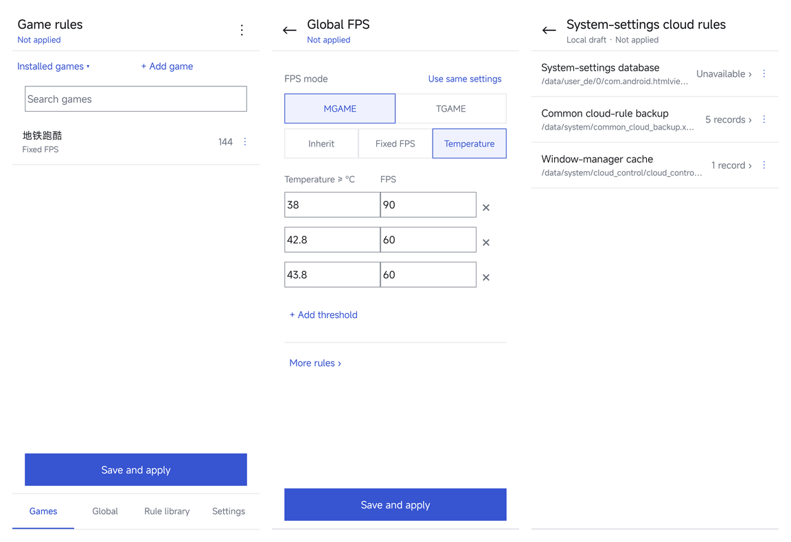

# JoyoseLeash

[简体中文](README.md) | English

A Xiaomi cloud-rule editor with a visual rule interface, a KernelSU network-blocking module, and Java hooks loaded through Zygisk / LSPosed.

Current version: **0.3.3 Beta** (versionCode **9**). The app follows the system locale for Chinese or English. Raw field keys, user input, and rule data remain unchanged.

**Beta releases may contain unexpected issues. Back up your data and report any problems.**



## Features

- Enter, increment, decrement, or select game frame rates; edit temperature bands on the same page, with separate MGAME / TGAME settings.
- Edit PID thermal parameters, MIGT CPU frequencies / frame times, app frame rates, TGAME recommendation thresholds, and scene commands in native field editors. Unrecognized fragments are preserved.
- Four sections: Games, Global, Rule library, and Settings. A native, square-cornered interface with a single title bar and bottom tabs edits fields by type.
- Manage rule versions, lock the current rules, and add games, fields, and rule libraries absent from the original database.
- Create, rename, reorder, and change the types of named fields. Convert existing list items to named fields only after confirmation.
- Find rules in historical backups, system caches, ROM presets, and downloaded cloud rules; preview before replacing and applying.
- Block cloud-control domains and discovered server IP addresses through loopback rules; update addresses manually.
- Request current rules through the Joyose and system cloud clients, or apply local edits immediately.
- Automatic backups and local drafts. Game data is not cleared, and original system rule databases are opened read-only.
- Browse system-settings cloud rules separately and edit local drafts. Source files are read-only; applying these drafts to the system is not supported.

## Installation

A compatible device with KernelSU, Zygisk, and LSPosed configured is required.
Only Xiaomi haotian, OS4.0.0.17.XOBCNXM, and Joyose 2.5.21 have been tested; see [Compatibility and limits](docs/COMPATIBILITY.en.md).
The project does not provide a standalone native Zygisk `.so`; LSPosed loads the hooks.

1. Download the matching KSU ZIP from [Releases](https://github.com/imuyue/JoyoseLeash/releases). For local builds, see [Build](docs/BUILD.en.md).
2. Install `JoyoseLeash-KSU-0.3.3.zip` in KernelSU. The installer installs or updates the bundled manager APK while retaining data. The standalone APK is `JoyoseLeash-0.3.3.apk`.
3. Enable JoyoseLeash in LSPosed and select **Joyose** and **HTML Viewer** as its scope. Reboot after the first installation.
4. Open the manager and grant it Root access in KernelSU. The module action button can also open the app.

## Usage

| Page | Action |
| --- | --- |
| Games | Find or add a game, edit the fixed frame rate / temperature bands, and select “Save and apply” |
| Global | Edit the default frame rate, rule version, rule lock, and global fields |
| Rule library | Browse by source; select a rule to preview it or “Replace” to confirm replacement; “Fetch cloud rules” requests both download sources |
| Settings | Manage server blocking and address-discovery blocking, then select “Save blocking settings”; view system cloud rules, status, and About |

Navigation and editing use local data. Unapplied changes remain in the draft. Manual downloads temporarily allow network access for up to 90 seconds, then restore blocking. Downloaded rules must be selected, replaced, and applied separately.

Configured frame rates and actual game frame rates require separate verification. Whether an unknown field takes effect depends on system support. Network blocking also depends on request entry points, server address changes, and kernel capabilities.

## Data and recovery

Saved rules and unapplied drafts are stored in the app’s private directory. Automatic rule backups are stored in `/data/adb/cloudruleguard/history/`. Uninstalling the KSU module removes its network blocking and local overrides, but retains the manager and rule backups. See [Data and recovery](docs/COMPATIBILITY.en.md#data-and-recovery) for paths and limits.

## Build and development

```sh
python tools/build.py
python tools/export_source.py
```

Configure the JDK, Android SDK, and Xposed API as described in [Build](docs/BUILD.en.md). Build artifacts are written to `dist/`; source archives contain only public source and documentation. Local dependencies, keys, and device records remain in the ignored `.local/` directory.

- [Build, signing, and source export](docs/BUILD.en.md)
- [Project layout, device tools, and verification](docs/DEVELOPMENT.en.md)
- [Compatibility and known limits](docs/COMPATIBILITY.en.md)
- [String editing and JoyCtl attribution](docs/STRING_RULES.en.md)
- [System cloud rules](docs/SYSTEM_CLOUD.en.md)
- [Named fields in lists](docs/NAMED_FIELDS.en.md)
- [Translations and adding languages](docs/LOCALIZATION.en.md)
- [Changelog](CHANGELOG.en.md)
- [Third-party notices](THIRD_PARTY_NOTICES.en.md)

Some field names, matching logic, and PID / MIGT parsing are derived from [JoyCtl](https://github.com/hexwander/joyctl) under the MIT License. See [Third-party notices](THIRD_PARTY_NOTICES.en.md) and the [original license text](licenses/JoyCtl-MIT.txt).

Issue reports should include the device model, ROM, Android / Joyose versions, module version, and reproduction steps. Remove personal information from logs and screenshots before sharing.
