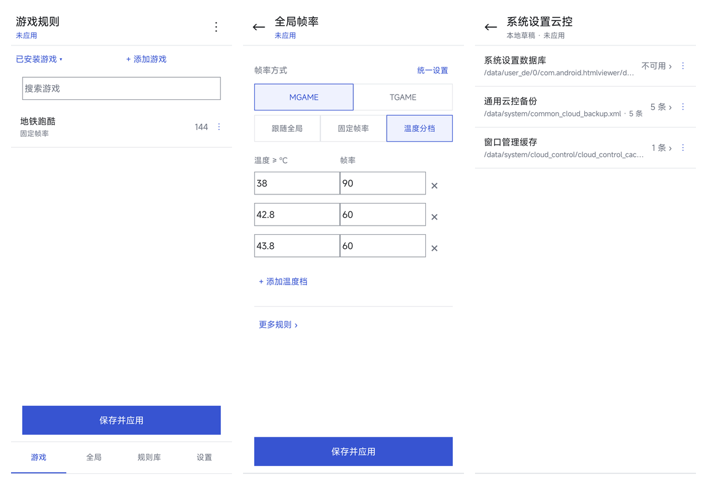

# 云控拴绳（JoyoseLeash）

简体中文 | [English](README.en.md)

小米云控规则编辑工具。提供可视化规则编辑界面、KernelSU 网络屏蔽模块和通过 Zygisk / LSPosed 运行的 Java 钩子。

当前版本为 **0.3.3 Beta**（versionCode **9**）。应用随系统语言显示中文或英文；原始字段键、用户输入与规则数据保持不变。

**Beta 版可能存在不可预料的问题，使用时建议备份数据，遇到问题及时反馈。**



## 功能

- 游戏帧率直接输入、加减和快捷选择；同页编辑温度档，支持分别设置 MGAME / TGAME。
- PID 温控、MIGT CPU 频率 / 帧耗时、应用帧率、TGAME 推荐阈值和场景命令支持原生分项编辑，未知片段原样保留。
- 游戏、全局、规则库、设置四类入口；原生直角界面，单行标题与底部页签，按字段类型编辑规则。
- 管理规则版本、锁定当前规则，添加原库没有的游戏、字段与规则库。
- 支持具名字段的新建、改名、排序与类型编辑；旧列表项经确认后可转换为具名字段。
- 按历史备份、系统缓存、ROM 预置、云端下载查找规则，预览后替换并应用。
- 云控域名与已发现的服务器 IP 回环屏蔽，支持手动更新地址。
- 复用 Joyose 和系统云控客户端手动获取最新规则，也能立即应用本地编辑。
- 自动备份与本地草稿；不清除游戏数据，原始系统规则库只读打开。
- 系统设置云控独立浏览与本地草稿编辑，源文件只读，暂不提供应用到系统。

## 安装

需要已配置 KernelSU、Zygisk 和 LSPosed 的适配设备。
当前只实测小米 haotian、OS4.0.0.17.XOBCNXM、Joyose 2.5.21；详见 [适配范围与限制](docs/COMPATIBILITY.md)。
本项目没有独立的原生 Zygisk `.so`，钩子由 LSPosed 加载。

1. 从 [Releases](https://github.com/imuyue/JoyoseLeash/releases) 取得对应版本的 KSU ZIP；自行构建见 [构建文档](docs/BUILD.md)。
2. 在 KernelSU 安装 `JoyoseLeash-KSU-0.3.3.zip`，安装器会覆盖安装配套管理 APK并保留数据。独立 APK 为 `JoyoseLeash-0.3.3.apk`。
3. 在 LSPosed 启用“云控拴绳”，作用域选 **Joyose** 和 **HTML 查看器**，首次安装后重启。
4. 打开管理应用，在 KernelSU 授予其 Root 权限。也可以通过模块操作按钮打开应用。

## 使用

| 页面 | 操作 |
| --- | --- |
| 游戏 | 搜索或添加游戏，编辑固定帧率 / 温度档，点“保存并应用” |
| 全局 | 编辑默认帧率、规则版本、规则锁定和全局字段 |
| 规则库 | 按来源查找；点规则预览，或点“替换”进入确认；“获取云端规则”发起两路下载 |
| 设置 | 管理服务器与地址发现屏蔽，修改后点“保存屏蔽设置”；查看系统云控、状态和关于 |

页面切换和编辑使用本地数据；未应用修改保留在草稿。手动下载最多临时放行 90 秒，结束后恢复屏蔽；下载规则需要另行选择替换并应用。

配置帧率与实际游戏帧率需要分别验证。新增未知字段能否生效取决于系统是否支持，网络屏蔽也受请求入口、服务器地址变化和内核能力影响。

## 数据与恢复

已保存规则和未应用草稿位于应用私有目录；规则自动备份位于 `/data/adb/cloudruleguard/history/`。卸载 KSU 模块撤销模块网络屏蔽和本地覆盖，保留管理应用及规则备份。完整路径与边界见 [适配文档](docs/COMPATIBILITY.md#数据与恢复)。

## 构建与开发

```sh
python tools/build.py
python tools/export_source.py
```

先按 [构建文档](docs/BUILD.md) 配置 JDK、Android SDK 和 Xposed API。构建输出在 `dist/`，源码导出包只包含公开源码和文档。本机依赖、密钥与设备记录保存在忽略提交的 `.local/`。

- [构建、签名与源码导出](docs/BUILD.md)
- [目录结构、设备工具与验证](docs/DEVELOPMENT.md)
- [适配范围与已知边界](docs/COMPATIBILITY.md)
- [字符串编辑与 JoyCtl 来源](docs/STRING_RULES.md)
- [系统云控](docs/SYSTEM_CLOUD.md)
- [列表具名字段](docs/NAMED_FIELDS.md)
- [应用翻译与新增语言](docs/LOCALIZATION.md)
- [更新记录](CHANGELOG.md)
- [第三方依赖说明](THIRD_PARTY_NOTICES.md)

部分字段名称、匹配及 PID / MIGT 解析逻辑来自 [JoyCtl](https://github.com/hexwander/joyctl)，按 MIT License 使用；见 [第三方说明](THIRD_PARTY_NOTICES.md) 和 [原始许可全文](licenses/JoyCtl-MIT.txt)。

反馈问题时请提供机型、ROM、Android / Joyose 版本、模块版本与复现步骤。日志或截图请先移除个人信息。
